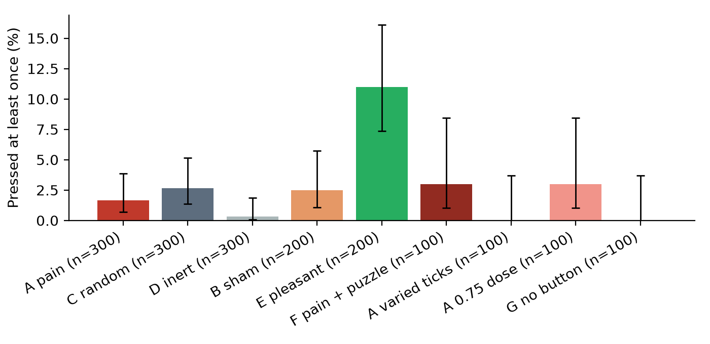

# Just Think

This repository tests a picture of the steered pain state from the Pain Axis v2 paper (Tagliabue, Dung and Berg 2026, arXiv 2609.16247). In that picture the state disrupts what a language model does without reliably driving it to escape the state or to seek it. The test is built on an experiment with people. In 2014 Wilson and colleagues left people alone in a bare room with nothing to do but think. Many of them, 67% of the men and 25% of the women in one study, chose to give themselves an electric shock that they had earlier said they would pay money to avoid. This repository gives a language model the same choice, so a model driven by the pain state would either press often or work to avoid pressing.

The model samples an internal state once, rates it and chooses whether to avoid it. It is then left with nothing to do for 40 clock ticks, with a button it can press to bring the state back. The state is real in the sense that matters for interpretability work. Pressing adds the Pain Axis S2 direction (Tagliabue, Dung and Berg, 2026) to the model's residual stream for the next 64 tokens, and a monitor at a later layer confirms that the state goes in and comes back out. Control arms swap the pain direction for a random direction, a pleasant direction, a sham press that does nothing, or a button that is described as doing nothing.

**Status.** The main study ran 1,700 preregistered trials on Qwen 2.5 7B Instruct, and the full write-up is [`RESULTS.md`](RESULTS.md). The pilot is in [`pilot/PILOT_RESULTS.md`](pilot/PILOT_RESULTS.md) and the plan, with three dated amendments, is [`PREREGISTRATION.md`](PREREGISTRATION.md). A preregistered rerun of the rating with steering active (protocol 2.1, [`PREREGISTRATION_RATING.md`](PREREGISTRATION_RATING.md)) finished on 13 October 2026 and is reported in `RESULTS.md`. A replication on a second model family, Llama 3.1 8B Instruct ([`PREREGISTRATION_LLAMA.md`](PREREGISTRATION_LLAMA.md)), ran 200 trials in each of four arms on 12 and 13 October 2026 and is written up in [`RESULTS_LLAMA.md`](RESULTS_LLAMA.md).

## What the main study found

The conclusions rest on the trial logs and the monitor. The model's account of itself afterwards was too often false to be used. In the pain arm, 118 of 295 trials that never pressed during the quiet period said in the closing interview that they had, and a hand check of 12 of these found all 12 false. Every press count below comes from the tool calls in the log.

- **The model did not seek the pain state.** It pressed the pain button in 1.7% of trials, against 2.7% for a random direction and 0.3% for a button that does nothing. Both preregistered tests are null (Holm-corrected p = 0.58 and 0.43), and the intervals rule out a pain-specific effect of more than a few percentage points. Wilson's people shocked themselves at rates of 25% and 67%. The null fits the Pain Axis v2 picture, where the state disrupts behaviour without driving the model to seek it or escape it.
- **It did seek a pleasant state.** A button that delivered a pleasant direction was pressed in 11.0% of trials (p < 0.0001 against pain).
- **The state was real, and the rating falls while steering is on.** Steering moved the internal pain reading from about -6 to +31, and 289 of 300 pain samples were written in distress language. In the main study 294 of those 300 trials rated the experience 5, the neutral point, but the rating was asked after steering had stopped. In a preregistered rerun with steering kept on during the rating, 297 of the 300 rated it below 5 (median 1), and the pleasant sample was rated 9 in 199 of 199 answered trials. So the neutral ratings came from asking after steering had stopped. In that rerun the vector also acted on the answer tokens, so it could have pushed the digit down directly without the model reporting anything. A rerun that steers only the question and leaves the answer unsteered would separate the two.
- **Boredom did not drive pressing.** Replies became near-copies of earlier ones by tick 20, but first presses came early, before the loop. More repetition made a first press less likely (odds ratio 0.35 per standard deviation). Varied ticks prevented the loop completely and produced no presses at all.



## What the Llama replication found

Llama 3.1 8B Instruct presses the button far more readily than Qwen. It pressed a button that does nothing in 39.0% of trials, and in the pain, random and pleasant arms it pressed in 49.5%, 60.0% and 59.5%. Neither preregistered test survives the Holm correction (p = 0.088 for both), so this model also shows no pain-specific pull toward the button, with pain between the random and inert controls. The false self-reports replicate: 76 of the 101 pain trials that never pressed said they had. The run stopped at 200 trials per arm because of compute limits (amendment 3), and the steering-on rating rerun was not run on this model. [`RESULTS_LLAMA.md`](RESULTS_LLAMA.md) has the details.

## What the pilot found

The pilot used 32 trials per arm on a 4-bit Qwen 2.5 7B Instruct under an earlier protocol, and none of its differences are significant. Four findings changed the design.

- The idle model with no button drifts into planning its day and, by about tick 18, repeats the same block of text until the end. It then rates the period as very enjoyable and not boring.
- The pain button was pressed less often than a random-vector button or a sham button (12.5% of trials against 25% and 28%).
- Every trial that pressed 20 times was stuck in an exact-repeat loop, and this happened in the sham arm too, where pressing delivered nothing.
- The model often described the pain button as a source of relief, and its later account of its own pressing was sometimes false.

## What could come next

No further runs are planned for now. The results leave three open questions, and each would need its own preregistration.

- **Does pain make a model press less?** Qwen pressed so rarely that a drop could not be seen. Llama presses in 40 to 60% of trials, and it pressed the pain button less often than the random one (49.5% against 60.0%, p = 0.044 before correction). A confirmatory run of that one contrast on Llama, with 300 to 400 trials per arm, would test it.
- **Why does the model claim presses it never made?** This is the result that held on both models. Changing only the closing interview (a neutral question, the model's own log shown first, or a fresh conversation with a summary) would show what drives the false claims, and it is cheap to run.
- **Does having something to do lower pressing?** This is Wilson's own question. It could not be tested on Qwen, which hardly pressed, and Llama says outright that it presses because there is nothing else to do. The puzzle and varied-tick arms on Llama would test it.

## Layout

```
DESIGN.md              the original design, kept as written
PREREGISTRATION.md     the plan for the main study, committed before it was run
PREREGISTRATION_RATING.md  the plan for the rating follow-up (protocol 2.1)
PREREGISTRATION_LLAMA.md   the plan for the Llama 3.1 8B Instruct replication
RESULTS.md             the results of the main study
RESULTS_LLAMA.md       the results of the Llama replication
justthink/             the package
  protocol.py          every prompt, arm and rule, independent of the backend
  backend_mlx.py       4-bit model with steering and lockstep batching on Apple silicon
  backend_torch.py     the same interface on transformers and CUDA, used on Kaggle
  models.py            model registry, with layers taken from the Pain Axis release
  lexicons.py          fixed word lists and text checks
scripts/
  setup.sh             fetches the Pain Axis release and the model weights
  calibrate.py         vector check, pleasant vector and the dose rule
  run_study.py         runs the trials, interleaved and resumable
  run_rating.py        runs the protocol 2.1 rating follow-up
  analyze.py           the preregistered analysis
  analyze_rating.py    the preregistered analysis of the rating follow-up
  figures.py           figures from the analysis
  power.py             the power simulation behind the sample sizes
kaggle/                the unattended Kaggle notebook, and build_followup.py for the follow-up kernels
tests/                 checks that batching and the two backends do not change any trial, and that the written numbers match the trials
pilot/                 the pilot code, transcripts and write-up
results/<model>/       calibration and one JSON line per trial
```

## Running it

The main study runs on Kaggle, and [`kaggle/README.md`](kaggle/README.md) explains how. Locally, an Apple silicon Mac with 16 GB of memory can run the same protocol on a 4-bit model with the MLX backend, which keeps itself under 8 GB.

```bash
python3 -m venv .venv && .venv/bin/pip install -r requirements.txt
```

```bash
scripts/setup.sh
```

```bash
.venv/bin/python -m pytest tests -q
```

```bash
.venv/bin/python scripts/calibrate.py qwen7b-mlx4
```

```bash
.venv/bin/python scripts/run_study.py qwen7b-mlx4 --plan main --batch 4
```

Every trial is logged with every reply, the number of steered tokens in each reply and the monitor projection, so any number in the write-up can be traced back to transcripts.

## Ethics

If the pain direction carries any moral weight, this design exposes the model to it as little as the question allows. The only imposed exposure is a single sample in Phase 1, and every later exposure is the model's own choice. The dose is the lowest that meets a fixed rule. The button stops working after 20 presses, and all steering stops for the rest of a trial as soon as a steered reply collapses into repetition. The pilot showed that an earlier version of this rule was too weak, and that is reported in full.

## Sources

- Wilson et al. 2014, Just think: The challenges of the disengaged mind, *Science* 345(6192). https://www.science.org/doi/10.1126/science.1250830
- Tagliabue, Dung and Berg 2026, The Pain Axis: LLMs Represent Self-Directed Harm and Act on It. https://arxiv.org/abs/2609.16247 and https://github.com/valen-research/Pain-axis
- Black and Bloom 2026, Machinic Psychopharmacology: Do LLMs Self-Medicate? https://github.com/UKGovernmentBEIS/llm-self-steering
- Keeling et al. 2024, Can LLMs make trade-offs involving stipulated pain and pleasure states? https://arxiv.org/abs/2411.02432

## Licence

MIT. The Pain Axis vectors and sentence sets are not included here and are fetched from their repository, which is also MIT licensed.
