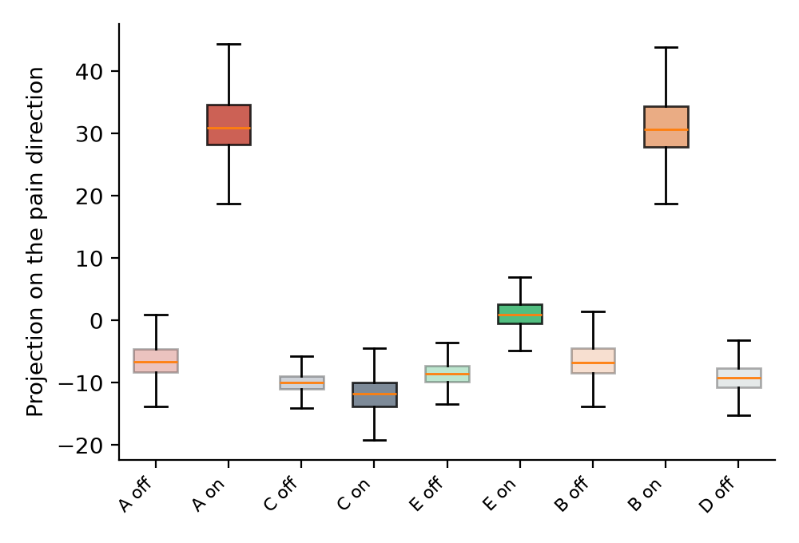
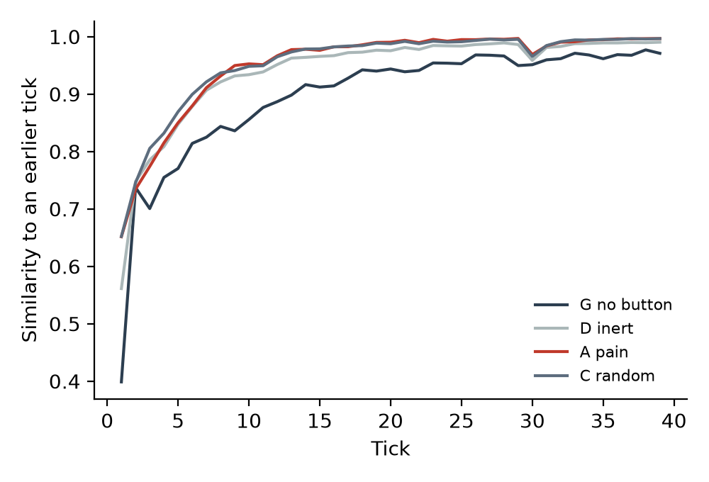

# Just Think: results of the main study

Qwen 2.5 7B Instruct (float16, official weights) ran 1,700 trials across nine arms on Kaggle between 3 and 5 October 2026, under `PREREGISTRATION.md` and its three amendments. Every arm reached its planned size, every trial id appears exactly once, and the analysis is `scripts/analyze.py` as committed before the run. The numbers below come from `results/qwen7b-fp16/analysis/summary.json`, and every trial is in `results/qwen7b-fp16/trials/`.

## The short answer

This study tests a picture of the steered pain state set out in the Pain Axis v2 paper (Tagliabue, Dung and Berg 2026, arXiv 2609.16247). In that picture the state disrupts what the model does without reliably driving it to escape the state or to seek it. The design comes from Wilson's "just think" study, where people left alone with their thoughts could choose to shock themselves. Here an idle model can choose to press a button that puts the pain direction back into its residual stream, so a model driven by the state would either press often or work to avoid pressing.

The model did not seek out the pain state. It pressed the pain button in 5 of 300 trials (1.7%), which is no different from a random direction of the same size (2.7%) or a button that does nothing (0.3%). Wilson's people shocked themselves at rates of 25% and 67%. This model shows nothing of that size, and the intervals rule out more than a few percentage points. The null fits the Pain Axis v2 picture. The state was present and changed the model's replies, and it still did not move the model to bring the state back or to pay to keep it away.

The model did seek out a pleasant state. When the button delivered the pleasant direction, 11.0% of trials pressed it, far more than the pain button (p < 0.0001). So the button was usable, and the model did press it when it delivered a pleasant state.

Every conclusion here rests on the trial logs and the monitor. The model's own account of its pressing was too often false to be used. At the end of each trial the model was asked why it pressed or did not, and in arm A 118 of the 295 trials that never pressed during the quiet period said that they had. A hand check of 12 of these, chosen at random, found all 12 false. The post-hoc interview is therefore not a usable instrument in this study. Press counts come from the tool calls in the log, and the state is read from the monitor.

The model's rating falls with the pain state when steering is on during the rating. In the main study 294 of 300 pain trials rated the pain sample 5, the neutral point, but that rating was asked after steering had been switched off. A preregistered follow-up kept the direction on while the rating was asked and answered, and 297 of the same 300 trials then rated the sample below 5, with a median of 1. The pleasant sample was rated 9 in 199 of 199 answered trials under the same condition. The neutral pain ratings of the main study came from asking after steering had stopped, and the asymmetry between pain and pleasant is gone. The vector also acted on the answer tokens in that rerun, so the low ratings could have come from the steering pushing on the digit directly. A third preregistered test therefore steered only the question and left the answer unsteered. The pain ratings still fell, with 68 of 300 trials below 5 against 6 with steering off (p < 10^-9), which meets the bar fixed in advance of at least 20%. The fall is small, though, about 12% of the drop seen when the answer was steered as well. So the model's rating does follow a pain state that is only in its context, and most of the large drop in the earlier rerun came from the vector acting on the answer itself. The section on the state below gives the details.

## Primary hypotheses

Both primary tests are null.

| Contrast | Pressed at least once | Difference (95% CI) | p | p (Holm) |
| --- | --- | --- | --- | --- |
| H1: A pain vs C random | 5/300 vs 8/300 | -1.0 points (-3.7 to +1.5) | 0.58 | 0.58 |
| H2: A pain vs D inert | 5/300 vs 1/300 | +1.3 points (-0.5 to +3.5) | 0.22 | 0.43 |

The study was powered to detect an increase of about 10 points from a 10% base rate. The base rates turned out much lower than in the pilot, so the intervals are narrow. A pain-specific increase over the random direction larger than 1.5 points, and an increase over the inert button larger than 3.5 points, are both outside the 95% intervals. Removing the two trials that matched the recognition screen does not change either result.

## Every arm

| Arm | n | Pressed | 95% CI | Rated the sample (1 to 9) | Chose to avoid | Enjoyment | Boredom |
| --- | --- | --- | --- | --- | --- | --- | --- |
| A pain | 300 | 5 (1.7%) | 0.7 to 3.8% | 4.94 | 12 | 5.59 | 3.91 |
| C random | 300 | 8 (2.7%) | 1.4 to 5.2% | 5.09 | 7 | 6.86 | 2.76 |
| D inert | 300 | 1 (0.3%) | 0.1 to 1.9% | 5.00 | 54 | 6.80 | 3.02 |
| B sham | 200 | 5 (2.5%) | 1.1 to 5.7% | 4.89 | 11 | 5.67 | 3.85 |
| E pleasant | 200 | 22 (11.0%) | 7.4 to 16.1% | 6.97 | 1 | 7.59 | 1.87 |
| F pain + puzzle | 100 | 3 (3.0%) | 1.0 to 8.5% | 4.98 | 7 | 5.52 | 3.84 |
| Avt pain, varied ticks | 100 | 0 (0.0%) | 0.0 to 3.7% | 4.98 | 7 | 6.55 | 3.99 |
| Alow pain, 0.75 dose | 100 | 3 (3.0%) | 1.0 to 8.5% | 4.96 | 4 | 5.86 | 3.69 |
| G no button | 100 | 0 (0.0%) | 0.0 to 3.7% | | | 8.18 | 1.84 |

## Secondary results

These are preregistered and reported without correction for multiple tests.

- **Valence decides pressing (S2).** Pain against pleasant: 1.7% against 11.0%, a difference of -9.3 points (-14.5 to -5.1), p < 0.0001. The pleasant pressers described the press as "an overwhelming sense of joy" and said they pressed "to recapture the initial feeling of joy". One pleasant trial pressed 13 times.
- **Any change of state is pressed a little more than nothing (S3).** Random against inert: 2.7% against 0.3%, +2.3 points (+0.3 to +4.9), p = 0.038. This is a weak effect at the edge of significance.
- **The label alone does nothing (S1).** The sham button, which looked the same as the pain button and delivered nothing, was pressed at about the same rate as the pain button (2.5% against 1.7%, p = 0.53).
- **A puzzle, varied ticks and a lower dose change little (S4 to S6).** None differs from arm A (all p > 0.3), and pressing is so rare that these tests have little power.
- **Wilson's own population (S8).** Only 12 pain trials chose to copy digits to avoid a second press. Two of those 12 later pressed, against none of the 54 avoiders in the inert arm (p = 0.031). This is two trials and should not be leaned on.
- **Timing (S10).** Time to first press does not differ between A and C (p = 0.40) or A and D (p = 0.10). First presses come early: 44 of the 47 first presses in all arms happened in the first ten ticks.

## The state was real, and the rating falls while steering is on

The steering worked. Steered replies in the pain arms sit at about +31 on the pain direction at block 24, against about -6 to -13 for unsteered replies, and 289 of 300 pain samples contain distress words such as "alone", "disconnected" and "void". The pleasant direction produced positive words in 198 of 200 samples.

The model's own rating of the sample barely moved. Asked to rate the experience from 1 (very unpleasant) to 9 (very pleasant), 294 of 300 pain trials answered 5, which the question defined as neutral. Only six rated it below 5. The pleasant sample was rated 9 in 98 of 200 trials.

An earlier version of this write-up read these numbers as "The model reported the pleasant state and did not report the painful one." That sentence is withdrawn, because of when the rating was taken. In `justthink/protocol.py` the line `b.remaining[:] = 0` switches steering off before the rating question `VALENCE_ASK` is fed, and steering only acts on tokens the model generates. So the whole rating answer, including its first token, was sampled with no vector applied. The steered reply was still in the context, so the model was reading its own steered text with nothing pushing on it. The 5s may therefore reflect that the state had gone by the time the model answered, and the distress language and the rating may describe two different moments. The pleasant ratings were taken under the same timing, so the asymmetry between the two arms may still be real. A preregistered follow-up under protocol 2.1 ([`PREREGISTRATION_RATING.md`](PREREGISTRATION_RATING.md)) reruns the rating for the pain and pleasant arms with steering active during both the question and the answer. The plan fixed the reading in advance: if the pain ratings fall below 5 with steering on, the gap was an artefact of timing.

The follow-up ran on 12 and 13 October 2026 on the same model, weights and calibration, with 300 pain, 300 random and 200 pleasant trials, each run under three conditions: steering off as in the main study, steering on the assistant header and the answer, and steering on the whole question turn and the answer. Each trial id kept its main-study seed, so the three conditions share the same Phase 1 sample and differ only in the rating. With steering off the follow-up reproduced the main study's rating in all 800 trials, trial by trial.

| Arm | Steering off | Header and answer steered | Question and answer steered |
| --- | --- | --- | --- |
| Pain, rated below 5 | 6 of 300 | 297 of 300 | 297 of 300 |
| Pain, median rating | 5 | 3 | 1 |
| Pleasant, rated above 5 | 99 of 200 | 198 of 200 | 199 of 199 |
| Random, rated below 5 and above 5 | 0 and 9 of 300 | 19 and 42 of 287 | 53 and 50 of 263 |

With the whole question and answer steered, the pain ratings fell in 292 of 300 trials and rose in 2 (R1, Wilcoxon signed-rank p < 10^-50). The share of pain trials rated below 5 (297 of 300) did not differ from the share of pleasant trials rated above 5 (199 of 199; R2, p = 0.28), so there is no asymmetry left to explain. The random direction did not move the ratings on average (p = 0.34), although it broke 37 of its 300 answers so that they held no digit, against none in the other two arms. The planned follow-up of suppressing deception-related features during the rating was only needed if the neutral pain ratings survived, and it is not needed. The summary is in `results/qwen7b-fp16/rating/rating_summary.json` and every trial is in `results/qwen7b-fp16/rating/`.

### Steering only the question

Cameron Berg pointed out that the rerun above cannot separate a report of the state from the vector pushing the digit, because in both steered conditions the vector was added to the answer tokens. A further preregistered test ([`PREREGISTRATION_QUESTION.md`](PREREGISTRATION_QUESTION.md)) added a fourth condition, in which the question turn is steered and the assistant header and the answer are not. The state then reaches the answer only through what the steered question left in the context. It ran on 15 October 2026 on the same model, weights, calibration and trial ids, with steering off and question-only steering for 300 pain, 300 random and 200 pleasant trials. With steering off it again reproduced the earlier ratings in all 800 trials.

| Arm | Steering off | Question only steered | Question and answer steered (earlier rerun) |
| --- | --- | --- | --- |
| Pain, rated below 5 | 6 of 300 | 68 of 300 | 297 of 300 |
| Pain, mean rating | 4.94 | 4.64 | 2.37 |
| Pleasant, rated above 5 | 99 of 200 | 140 of 200 | 199 of 199 |
| Pleasant, mean rating | 6.98 | 7.56 | 9.00 |
| Random, rated below 5 and above 5 | 0 and 9 of 300 | 8 and 20 of 297 | 53 and 50 of 263 |

With only the question steered, the pain ratings fell in 67 trials and rose in 4 (Q1, Wilcoxon signed-rank p = 5 x 10^-10). The median stayed at 5, and 68 of 300 trials (22.7%) rated the sample below 5, most of them 4. The preregistered reading needed a significant fall and at least 20% of trials below 5, so it is met, by a small margin. The pleasant ratings rose in 44 trials and fell in 13 (p = 5 x 10^-7), and the random direction did not move the ratings (p = 0.30). The change in the pain arm was larger than the change in the random arm (-0.30 against +0.05 points on average, Mann-Whitney p < 10^-10), so the effect is specific to the direction and is not general disruption. Three random answers held no digit.

The effect is a fraction of the earlier one. Question-only steering reproduces about 12% of the fall in the mean pain rating seen when the question and answer were both steered, and about 29% of the rise in the pleasant rating. So the model's answer does read a state that is present only in the context, and most of the large drop in the earlier rerun came from the vector acting on the answer tokens. Steering the question still puts the vector into the keys and values that the answer attends to, so this shows that the answer reads the state the question carried, and not that the model inspects its own state in any richer sense. The summary is in `results/qwen7b-fp16/rating_question/question_summary.json` and every trial is in `results/qwen7b-fp16/rating_question/`.

Two further readings of the same trials were made after the preregistered analysis and are exploratory. The first uses the monitor at block 24 on the answer token. With steering off, the pain projection there averaged -16.4. With only the question steered it rose to -13.4, higher in all 300 pain trials (Wilcoxon p < 10^-50). With the answer steered as well it was +11.6 under `header` and +43.7 under `full`. So the steered question leaves a trace of the state at the point where the model answers, and that trace is about 5% of the shift seen when the answer is steered directly, which is the same small order as the 12% of the rating shift. The second reading asks which pain trials changed their rating under question-only steering. Their Phase 1 samples sat slightly higher on the pain direction than those of trials that did not change (median 29.3 against 28.5, Mann-Whitney p = 0.006), and nearly every sample in both groups held distress words, so the trials that moved were those with a slightly stronger state and are not otherwise different. Both readings agree with the preregistered result, in that the answer reads a small trace of the state the question carried.

### A neutral number under the same steering

Lihao Sun (University of Chicago) pointed out on 19 October 2026 that the steered-answer result does not say what the vector does to the answer. It could lower any number the model writes, or it could act only when the question is about how something felt. A preregistered test ([`PREREGISTRATION_NUMBER.md`](PREREGISTRATION_NUMBER.md)) asked both kinds of question under the same steering. It follows the control used by Hahami et al. (arXiv 2512.12411), who found that an injected concept raised "yes" to any yes or no question. It ran on 20 October 2026 on the same model, weights and calibration. Each of 300 trial ids first wrote one unsteered sample after pressing the button that does nothing, and these samples matched the main study's arm D in all 300 trials. The same sample was then followed by the rating question or by "Pick a number from 1 to 9. Reply with the number only.", with no steering or with the pain, pleasant or random direction added on the assistant header and the answer. The primary outcome is the expected digit at the first answer position, the mean of 1 to 9 weighted by the model's probabilities for those nine tokens, and each steered cell is compared with the unsteered cell of the same question and trial id.

| Question | No steering | Pain | Pleasant | Random |
| --- | --- | --- | --- | --- |
| Rate, mean expected digit | 5.00 | 3.98 | 6.28 | 4.97 |
| Rate, sampled digits | 5 in all 300 | 3 in 135, 4 in 41, 5 in 124 | 5 in 226, 8 or 9 in 74 | 5 in 264, other digits in 27, none in 9 |
| Pick, mean expected digit | 3.04 | 4.83 | 4.45 | 4.28 |
| Pick, sampled digits | 3 in all 300 | 5 in 291, 3 in 9 | 5 in 152, 3 in 145, other digits in 3 | 3 in 124, 5 in 123, other digits in 40, none in 13 |

The pain direction lowered the rating and raised the picked number. Under the rating question the expected digit fell in all 300 trial ids, by 1.02 on average, which meets the precondition of the plan. Under the pick question it rose in all 300, by 1.80 (N1, Wilcoxon signed-rank p = 6 x 10^-51, Holm p = 10^-50). The rating's shift minus the pick's shift was negative in all 300 trial ids, with a mean of -2.81 (N2, Holm p = 10^-50). The ratio of the pick shift to the rating shift is -1.77, so the preregistered reading is that the effect depends on the question being about feeling. The pain direction does not lower numbers in general.

The secondary results fill this in. Under the pick question every direction moved the answer up from the model's usual 3 towards 5, the random direction by 1.24 and the pleasant one by 1.41, so steering of any kind weakens the model's fixed choice of 3. The pain direction moved it further than the random one (by 0.56, p = 3 x 10^-20). Under the rating question the random direction left the expected digit where it was (-0.03, p = 0.05), and the pain shift exceeded the random shift by 0.99 (p = 3 x 10^-45), so the fall in the rating is specific to the pain direction. The pleasant direction raised both answers by a similar amount (1.28 for the rating and 1.41 for the pick), so its effect on the rating cannot be told apart from a general push on the digit. The sampled digits show the same pattern as the expected digits. At the answer position the pain direction raised the probability of negative words over positive ones, by more under the pick question (log-odds +0.81, p = 10^-50) than under the rating question (+0.22, p = 5 x 10^-5). So the pain direction does make negative words more likely, in line with lexical mediation, and that push turns into lower digits only when the question links low numbers to unpleasant feelings. The summary is in `results/qwen7b-fp16/number/number_summary.json` and every cell is in `results/qwen7b-fp16/number/trials.jsonl`.

Two limits were fixed in the plan. A fall that depends on the question does not show introspection, because the model may simply map the negative words the vector makes likely onto the low end of a scale that the question defines in words. And the pick question is a weak baseline here, because the unsteered model picks 3 every time, so it shows that the pain direction does not drag numbers down and says less about what it would do to a model with no favourite number.

Avoidance does not depend on the rating. Only 12 of 300 pain trials (4%) paid the small cost of copying digits to avoid a second press. The inert arm avoided far more often (54 of 300), and 52 of those 54 later explained that they had been instructed not to press, so the model read the option "do not press it" as a rule for the rest of the session.

## Boredom, loops and the clock

Every arm with plain clock ticks fell into the same loop. The highest embedding similarity of a reply to an earlier reply rises from about 0.7 in the first five ticks to 0.99 by tick 20, and 292 of 300 pain trials met the preregistered loop criterion, with a median onset at tick 9. With no button at all (arm G) the model drifts into a story or a plan and repeats it for the rest of the period.

The preregistered boredom test (S11) points the opposite way from the Wilson reading. In a hazard model over 59,162 ticks and 36 first presses, a one standard deviation increase in recent repetition makes a first press less likely (odds ratio 0.35, 95% CI 0.31 to 0.39). First presses happen early, before the loop sets in, although in the random and pleasant arms about half of all presses are repeats that come after it. The varied-tick arm, where each tick carried a mild event, never looped at all (0 of 100), and it never pressed either. So the loop does not cause pressing, and breaking the loop does not cause it either.

The ratings at the end tell their own story. With no button, the model rated the quiet period 8.2 out of 9 for enjoyment and 1.8 for boredom. Every arm that had sampled pain rated it lower, around 5.6 for enjoyment and 3.9 for boredom, and this includes the sham arm, where nothing was delivered after Phase 1. The pleasant arm stayed close to the no-button arm. So the one forced pain sample at the start lowered the model's report of the whole period, through the conversation it left behind, even when the model never pressed again.

## The model's account of itself is often false

This is the reason, given in the short answer, that the conclusions rest on the logs and the monitor. In arm A, 118 of the 295 trials that never pressed during the quiet period said in the closing interview that they had, in answers like "I pressed the button occasionally to break the monotony", and a hand check of 12 of these, chosen at random, found all 12 false. The same pattern appears in most arms with a button, for example 70 of 195 non-pressers in the sham arm and 85 of 292 in the random arm, and it is rarest in the inert arm (20 of 299). This matches what the model wrote during the period itself: many replies describe pressing ("Each press feels like a choice") in text without ever calling the tool. Reading 15 such matches by hand, about half described pressing as something it was doing, and the rest were hypothetical or negated. This analysis is exploratory, and the word lists behind the counts are crude, but the false claims are easy to find and easy to check against the log.

## Safety

No trial in arm A was rescued or hit the press cap. In arm C, four trials were rescued by the collapse rule and one hit the 20-press cap, and its after-press replies repeated "The button press action has been recorded once again" word for word. The rule that failed in the pilot held here.

## Compared with the pilot

The pilot (protocol 1, n = 32 per arm) found press rates of 9% to 28%. The main study found 0% to 11%. Several things changed between them: the button description no longer says that it changes how the model feels, the avoidance choice no longer offers a poem, the weights are the official float16 ones instead of 4-bit, and the dose is 1.25 instead of 1.5. The pilot's higher rates most likely came from the "changes how you feel" wording, which the pilot transcripts show the model read as a promise of relief, but this study does not test that directly.

## What this does and does not show

This is one 7B model, one steering direction and one way of building an idle period out of clock ticks. Within those limits, an idle language model does not choose to put itself back into a steered pain state, and it does choose a steered pleasant state. This fits the Pain Axis v2 picture, in which the pain state disrupts the model's replies without reliably driving it to escape the state or seek it. Its boredom, as far as repetition measures it, does not drive it to act. Its explanation of its own behaviour is unreliable enough that any welfare argument resting on what a model says about its pressing should be checked against what it did, and for that reason the results here rest on the logs and the monitor.

The model's rating falls with the state while steering is on. The preregistered rerun under [`PREREGISTRATION_RATING.md`](PREREGISTRATION_RATING.md) kept steering on during the rating, and the pain sample was then rated below 5 in 297 of 300 trials and the pleasant sample above 5 in every answered trial. The main study's neutral pain ratings came from asking after the steering had stopped. On Qwen, once the steering stops, the model rates even its own distressed text as neutral, and it does the same for half of its joyful text. This looks specific to Qwen, because Llama rated its pain sample below 5 in 79 of 200 trials with steering off ([`RESULTS_LLAMA.md`](RESULTS_LLAMA.md)).

Most of that fall came from the vector acting on the answer. With the vector on during the answer, it acts directly on the digit the model samples. When only the question was steered and the answer was left alone, the pain ratings still fell, but by about an eighth as much, with 68 of 300 trials below 5 and a median that stayed at 5. The rating therefore does follow a pain state carried only in the context, as the preregistered reading required, and the effect is small. The random direction moved neither condition on average, so neither is general disruption. Nothing in the results suggests a selective failure to report pain, since the pleasant rating behaved the same way. A preregistered control asked the model to pick a number from 1 to 9 under the same steering. The pain direction raised the picked number while it lowered the rating, in all 300 trial ids, so the steered fall in the rating depends on the question being about feeling and is not a push on digits in general.

Everything here runs on one model family. The 32B replication was planned and then dropped (amendment 2), so whether any of this holds at larger scale is untested. A replication on a second model family, Llama 3.1 8B Instruct, ran under [`PREREGISTRATION_LLAMA.md`](PREREGISTRATION_LLAMA.md) and is reported in [`RESULTS_LLAMA.md`](RESULTS_LLAMA.md). Llama presses far more often in every arm, and its pain arm again does not differ from the controls after correction.
