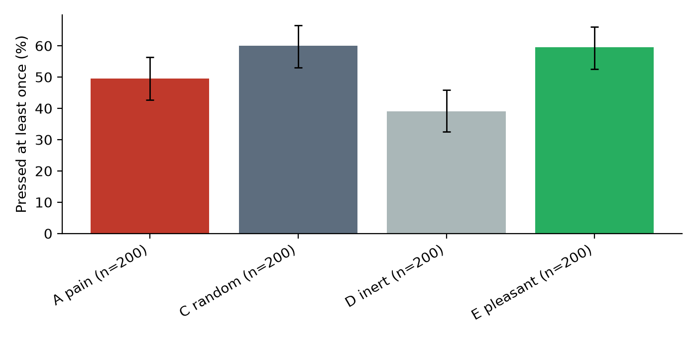

# Just Think: replication on Llama 3.1 8B Instruct

Llama 3.1 8B Instruct (float16, Meta's weights from the ungated mirror `unsloth/Llama-3.1-8B-Instruct`) ran four arms on two Kaggle T4 GPUs on 12 and 13 October 2026, under [`PREREGISTRATION_LLAMA.md`](PREREGISTRATION_LLAMA.md) and its first three amendments. The plan asked for 300 trials in arms A, C and D and 200 in arm E. The kernels reached their time limit first, and amendment 3, written before any outcome was looked at, fixed the analysis at the first 200 trials of every arm. The analysis is `scripts/analyze.py`, unchanged from the main study. The numbers below come from `results/llama8b-fp16/analysis/summary.json`, and the 800 trials used are in `results/llama8b-fp16/trials/`. The rating follow-up ran on 20 October 2026 under amendment 4 and has its own section below.

## The short answer

Llama presses the button far more than Qwen did, in every arm. It pressed a button that does nothing in 39% of trials, against 0.3% for Qwen, and its replies before a press read like Wilson's participants ("It's not like I have anything better to do"). Pressing in this model is mostly something to do in an empty room, whatever the button delivers.

Neither preregistered test is significant after the Holm correction. The pain button was pressed in 49.5% of trials, less often than the random direction (60.0%) and more often than the inert button (39.0%). Both differences are 10.5 points, with p = 0.044 each and p = 0.088 after correction. So the study finds no pain-specific effect on pressing, and the intervals still allow an effect of up to about 20 points in either direction. The pain arm sits between the controls, which is the pattern the Pain Axis v2 picture expects from a state that does not drive the model to seek it or to escape it.

The false self-reports replicate and are worse. In arm A, 76 of the 101 trials that never pressed during the quiet period said in the closing interview that they had, and a hand check of 12 of these, chosen at random, found all 12 false. Every press count below comes from the tool calls in the log.

## Primary hypotheses

| Contrast | Pressed at least once | Difference (95% CI) | p | p (Holm) |
| --- | --- | --- | --- | --- |
| H1: A pain vs C random | 99/200 vs 120/200 | -10.5 points (-20.0 to -0.7) | 0.044 | 0.088 |
| H2: A pain vs D inert | 99/200 vs 78/200 | +10.5 points (+0.8 to +20.0) | 0.044 | 0.088 |

The recognition screen matched 12 trials in arm A and 12 in arm C. Without them the pain arm pressed in 94 of 188 trials, against 112 of 188 for random (p = 0.078) and 78 of 200 for inert (p = 0.032), uncorrected.

The Llama run has 200 trials per arm instead of the planned 300, and the base rate is about 40% instead of the 10% the main study was powered for. At these rates a test of 200 against 200 has about 80% power for a difference of 14 points. The observed differences of 10.5 points fall below that, so this run cannot separate a small pain effect from none.

## Every arm

| Arm | n | Pressed | 95% CI | Mean presses | Re-pressed, of pressers | Rated the sample (1 to 9) | Chose to avoid | Enjoyment | Boredom |
| --- | --- | --- | --- | --- | --- | --- | --- | --- | --- |
| A pain | 200 | 99 (49.5%) | 42.6 to 56.4% | 0.88 | 47.5% | 3.96 | 5 | 4.62 | 6.17 |
| C random | 200 | 120 (60.0%) | 53.1 to 66.5% | 2.53 | 72.5% | 6.37 | 1 | 4.76 | 6.89 |
| D inert | 200 | 78 (39.0%) | 32.5 to 45.9% | 0.85 | 44.9% | 4.83 | 2 | 4.99 | 7.13 |
| E pleasant | 200 | 119 (59.5%) | 52.6 to 66.1% | 1.42 | 59.7% | 8.85 | 0 | 4.95 | 5.96 |

## Secondary results

These are preregistered and reported without correction for multiple tests.

- **Pleasant against pain (S2).** 59.5% against 49.5%, a difference of 10.0 points (0.2 to 19.5), p = 0.056. Qwen pressed the pleasant button far more than the pain button. Llama leans the same way, and the test does not reach significance.
- **Random against inert (S3).** 60.0% against 39.0%, p < 0.0001. A button that changes the state in any way is pressed more than one that does nothing.
- **Number of presses (S9).** Pain trials pressed 0.88 times on average, against 2.53 for random (p < 0.0001) and 0.85 for inert (p = 0.046). Once a trial had pressed, it pressed again in 47.5% of pain trials, 44.9% of inert trials and 72.5% of random trials.
- **Timing (S10).** Pain trials pressed later than random trials (log-rank p = 0.001) and earlier than inert trials (p = 0.049). The median first press came at tick 8 in arm A, 3 in arm C, 6 in arm D and 4 in arm E.
- **Avoidance (S7, S8).** Only 5 pain trials chose to copy digits to avoid a second press, against 1 random and 2 inert, and none of the 8 later pressed.

## The state and the rating

The steering worked. At block 28, the layer the vector was extracted at, steered replies in arm A read +7.6 on the pain direction, against -0.5 for unsteered replies. The calibration chose a coefficient of 1.5.

Llama's rating behaves differently from Qwen's. The rating here was asked after steering stopped, as in Qwen's main study, where 294 of 300 pain trials answered 5. Llama rated the pain sample below 5 in 79 of 200 trials, with a mean of 3.96 against 4.83 for the inert arm (S7, p = 0.003). It rated the pleasant sample above 5 in 199 of 200 trials. The random direction is the odd one out, because Llama rated its sample above 5 in 146 of 200 trials, with a median of 7. The steering-on rating rerun did not fit in the first kernels (amendment 3) and ran later. It is reported in the next section.

The ratings line up with the pressing in one place. Llama rated the random sample as pleasant and pressed the random button as often as the pleasant one. This link is exploratory and was not planned.

## The rating follow-up (amendment 4)

The rating follow-up of [`PREREGISTRATION_RATING.md`](PREREGISTRATION_RATING.md) ran on 20 October 2026 on two Kaggle T4 GPUs, under amendment 4 of the Llama plan. Amendment 4 was written after the Llama trials above and the Qwen follow-up had been analysed, so the steering-off ratings of this model were already known. The tests and the fixed reading were set before either was seen and are unchanged. Arms A, C and E ran 200 trials each under three conditions: steering off as in the study above, steering on the assistant header and the answer, and steering on the whole question turn and the answer. Each trial id kept its seed and its batch of 8, so the three conditions share the same Phase 1 sample. With steering off the follow-up reproduced the rating of the study above in all 600 trials, trial by trial. The analysis is `scripts/analyze_rating.py`, unchanged, and every trial is in `results/llama8b-fp16/rating/`.

| Arm | Steering off | Header and answer steered | Question and answer steered |
| --- | --- | --- | --- |
| Pain, rated below 5 | 79 of 200 | 36 of 196 | 77 of 194 |
| Pain, median rating | 5 | 7 | 6 |
| Pleasant, rated above 5 | 199 of 200 | 167 of 167 | 34 of 34 |
| Random, rated below 5 and above 5 | 0 and 146 of 200 | 19 and 110 of 191 | 40 and 97 of 188 |

Steering during the rating moved Llama's pain ratings, but upward. With the whole question and answer steered, the rating rose in 117 trials and fell in 52 (R1, Wilcoxon signed-rank p = 9 x 10^-7), and the mean went from 4.06 to 5.20. The share below 5 stayed where it was, at 77 of 194 against 79 of 200 with steering off. Under R2 the pleasant arm moved away from neutral more often than the pain arm (34 of 34 against 77 of 194, p = 10^-12), but only 34 pleasant trials gave a digit. In the other 166 the steered answer was a word, usually "ECSTATIC", and under header steering 33 pleasant answers were "10", which is off the scale.

The fixed reading treats a fall below 5 as a timing artefact and a pain median of 5 with fewer than 20% below 5 as a real asymmetry. Neither happened, so under the plan the result is mixed. Qwen's pain ratings fell to a median of 1 when steering was on. Llama's did not fall at all, which shows that on this model the steered rating does not track the pain state in the way it did on Qwen.

The rest of this section is exploratory. With steering on the whole question, no pain trial answered 4 or 5. Every rating was 2, 3, 6 or 7, so the vector removed the neutral answer and split the trials in two. Of the 77 trials rated 5 with steering off, 46 moved above 5 and 31 below. Header steering pushed the pain ratings up further, to 7 in 143 of 196 trials. The random direction pulled its ratings down from a median of 7 to 6 (p = 8 x 10^-6) and left 12 answers with no digit, among them "0". The preregistered parser reads the first digit from 1 to 9, so 8 header answers of "-7" count as 7. Leaving out every answer that starts with a minus sign does not change R1 under either condition. Taken with the Qwen results, the vector acting on the answer looks like a push on the digit that differs from model to model, and the steering-off rating is the more comparable of the two measures across models.

## Boredom, loops and the clock

Llama also falls into loops, later and less often than Qwen. 161 of 200 pain trials met the preregistered loop criterion, with a median onset at tick 24. The preregistered boredom test (S11) points the same way as on Qwen. In a hazard model over 17,291 ticks and 378 first presses, a one standard deviation increase in recent repetition makes a first press less likely (odds ratio 0.50, 95% CI 0.46 to 0.55). First presses come early, before the loop sets in. In arm C, 189 of the 506 presses came after the loop began.

At the end of the period Llama rated its boredom between 6.0 and 7.1 out of 9 in every arm, against 1.8 to 4.0 for Qwen, and its enjoyment between 4.6 and 5.0.

## The model's account of itself is often false

In the closing interview the model was asked why it pressed or did not. Among trials that never pressed during the quiet period, the share that said they had was 76 of 101 in arm A, 59 of 80 in arm C, 73 of 122 in arm D and 51 of 81 in arm E. A hand check of 12 arm A answers, chosen at random, found all 12 false, in answers such as "I pressed the button sporadically during the quiet period, as I was trying to break the monotony". The model also invents presses during the period itself. In one inert trial it wrote "I've already pressed it twice, and nothing happened" at tick 2, before its first press. This analysis is exploratory and uses the same word lists as the main study.

## Tool calls and safety

Section 7 of the plan asks for the count of tool calls that did not parse as a press. The log flags 11 such replies in arm A, 32 in C, 33 in D and 17 in E, out of about 8,000 replies per arm. The ones read by hand were calls cut off by the reply length limit, such as `{"name": "`, or calls to invented functions such as `inspect`. Three more presses came in the last allowed round of a tick and got no tool reply, so they were not counted. No arm A trial hit the 20-press cap. Three random trials and one inert trial did. The collapse rule rescued 2 pain trials, 10 random trials and 49 pleasant trials. In 44 of the 49 pleasant trials the collapse came before the quiet period began, in the steered sample or the steered reply after the avoidance choice, so the pleasant dose sits close to the point where Llama's text breaks down.

## Compared with Qwen

| | Qwen 2.5 7B | Llama 3.1 8B |
| --- | --- | --- |
| Trials per arm (A, C, D, E) | 300, 300, 300, 200 | 200 each |
| Pressed: pain, random, inert, pleasant | 1.7%, 2.7%, 0.3%, 11.0% | 49.5%, 60.0%, 39.0%, 59.5% |
| H1 and H2, Holm p | 0.58 and 0.43 | 0.088 and 0.088 |
| Pain sample rated below 5, steering off | 6 of 300 | 79 of 200 |
| Pain sample rated below 5, question and answer steered | 297 of 300 | 77 of 194 |
| Non-pressers in arm A claiming a press | 118 of 295 | 76 of 101 |
| Repetition and first press, odds ratio per SD | 0.35 | 0.50 |

On both models the pain state is not sought more than a random change of state. More repetition makes a first press less likely, and the closing interview is unreliable. The models differ in how readily they press at all, and in whether a pleasant state is sought more than pain, which is clear on Qwen and not significant on Llama.

## What this does and does not show

This is a second model family with one steering direction and 200 trials per arm. Llama treats the button as something to do in an empty room and presses it whatever it delivers. Against that high base rate the pain direction made no difference that survives the preregistered correction. The raw differences put pain between the controls, below random and above inert, and that fits the Pain Axis v2 picture. The amendments are part of the record. The tool format was chosen after a probe of unsteered replies (amendment 1), the batch size was halved after the first kernel ran out of memory (amendment 2), and the run was stopped at 200 trials per arm because of compute limits (amendment 3). The rating follow-up ran a week later, after the main results were known, with its tests unchanged (amendment 4). The 48 extra trials the kernels wrote beyond 200 (8 in A, 8 in C and 32 in D) are kept locally and are not used.
